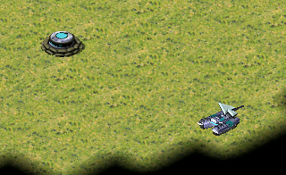

# 灰熊警戒哨站

盟军防御栏新增 **Grizzly Outpost**（灰熊警戒哨站）。它使用机枪碉堡的建筑外观、建造动画和图标，造价 1000，需要盟军建造厂和兵营。普通机枪碉堡仍可单独建造。

每座哨站有一个原版子机槽位。选中哨站，用设置工厂集合点的操作点击空地，灰熊就会低空前往，在警戒格落地，搜索周围 5 格内的敌人。它使用 105 毫米炮，每次携带一发炮弹，射击后返航补弹。重新设置集合点可以调动已出发的灰熊。子机损失后，哨站会按 `SpawnRegenRate=300` 补充一辆。

## 安装到已有模组

1. 按[流火安装说明](../../README.md#运行与测试)加载包含 ActSp 的 `Starfall.dll`。将 `asgrdrn.vxl` 和 `asgrdrn.hva` 放到游戏根目录。示例使用 Ares 的规则引入功能和 Phobos 的单发航空武器设置。
2. 将 `GrizzlyOutpost.rules.ini` 和 `GrizzlyOutpost.art.ini` 放在游戏根目录。在现有 `rulesmd.ini` 的 `[#include]` 节用一个空闲编号引入 `GrizzlyOutpost.rules.ini`，在 `artmd.ini` 的同名节引入 `GrizzlyOutpost.art.ini`。例如两个文件各自都有空闲的编号 50 时，分别写入 `50=GrizzlyOutpost.rules.ini` 和 `50=GrizzlyOutpost.art.ini`。也可以将两个片段的条目分别合并到对应规则和美术文件。
3. 重启游戏并开一局盟军遭遇战。在防御栏找到造价 1000 的 **Grizzly Outpost**，建好后给它设置集合点。

## 可调整的参数

| 配置节 | 参数 | 示例值 |
| --- | --- | --- |
| `[ASGRPOST]` | `SpawnsNumber`、`Drone.GuardRange` | 1 个槽位，警戒半径 5 格 |
| `[ASGRPOST]` | `SpawnReloadRate`、`SpawnRegenRate` | 补弹 75 游戏帧，补充损失 300 游戏帧 |
| `[ASGRDRN]` | `FlightLevel`、`Ammo` | 飞行高度 128 个游戏坐标单位，载弹量 1 |
| `[ASGR105]` | `Damage`、`Range` | 炮弹基础伤害 65，射程 5 格 |

子机注册为 `AircraftTypes`，飞行途中可以越过地面障碍。模型把原版灰熊的车身、炮塔与炮管合在一起，炮塔随车身转向。使用流火 Lua 时，也可在哨站的地面点选技能里调用 `ctx.self:setDroneGuardCell(ctx.point)` 设置同一个警戒格。
